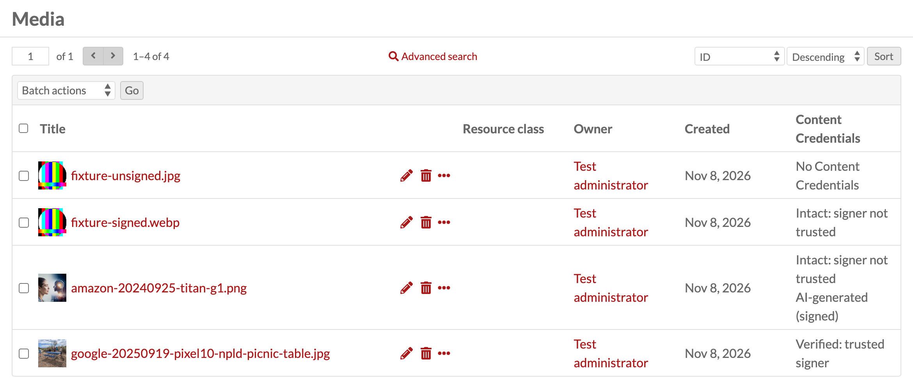
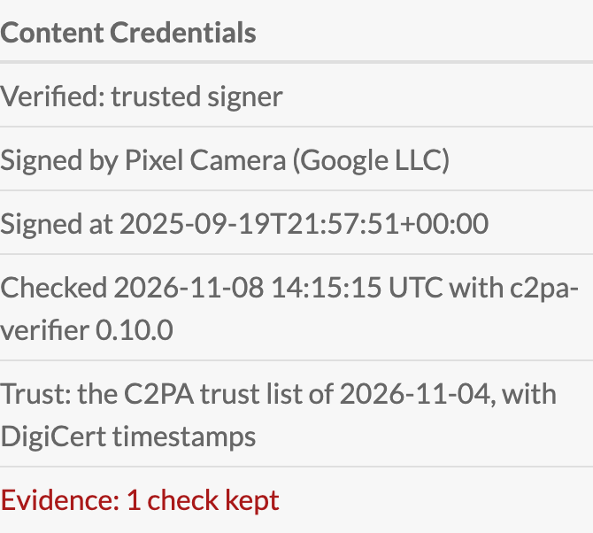

# Content Credentials (C2PA) for Omeka S

Content Credentials, the C2PA standard, are a signed record inside a media file: who made or edited
it, with which device or software, and whether generative AI was used. Some cameras, editing
programs and AI image generators add them. For an archive, library or museum the questions are
whether a file that comes in still carries a record that holds, who signed it, and whether that can
still be shown years later. This module answers them for every JPEG, PNG and WebP image uploaded to
Omeka S.

An Omeka S module that verifies the Content Credentials (C2PA) of every uploaded image, stores the
verdict with the media and shows it in the admin interface. It only checks: it never signs, never
blocks an upload and opens no network connection. Verification is done in pure PHP by
[`provemark/c2pa-verifier`](https://github.com/provemark/c2pa-verifier).

It also keeps the evidence behind each verdict: the certificates and time-stamps it rested on, and
the settings it was judged with. What held when a file came in stays on record after a certificate
has expired.

## Status

This is an early version (0.1.x). It is tested in a clean Omeka S 4.2.1, but has not yet
been used in production. The plan is in [`docs/milestones.md`](https://github.com/provemark/omeka-s-content-credentials/blob/main/docs/milestones.md) and the
decisions are in [`NOTES.md`](https://github.com/provemark/omeka-s-content-credentials/blob/main/NOTES.md).

## Requirements

- Omeka S 4.2.1 or a later 4.x
- PHP 8.3 or later; on an older PHP the module refuses to install. Tested on 8.3, 8.4 and 8.5.

The module was tested on Apache with MariaDB 11.4.

## Installing

Unpack `ContentCredentials-<version>.zip` in Omeka S's `modules/` folder, so that the folder
`modules/ContentCredentials` exists, and install the module on the modules page.

## What it does

**On upload.** Each new JPEG, PNG and WebP media item is verified once, after it is saved, and the
verdict is stored with it. Only the original file is checked. A failure never stops an upload.

**In the admin interface.** The media page and its Details panel show the verdict, and the media
browse has a column "Content Credentials" and a filter by verdict. Administrators who have chosen
their own browse columns do not get the column until they add it. The public site and the API's
media representation show nothing of this.

*Four test files in a clean Omeka S 4.2.1. The trusted one is a photo taken with a Google Pixel 10
(public domain, Wikimedia Commons); the AI-generated one is a test file signed by Amazon.*

| shown | verifier's state | meaning |
|---|---|---|
| Verified: trusted signer | `Trusted` | intact, and the signer is on the trust list |
| Intact: signer not trusted | `Valid` | intact, but the signer is not on the trust list |
| Does not verify | `Invalid` | the Content Credentials do not hold |
| No Content Credentials | | the file has none, which says nothing about its origin |
| Could not be checked | | the check failed, with the reason shown |

**Trust.** Files are checked against the C2PA trust lists bundled in [`trust/`](https://github.com/provemark/omeka-s-content-credentials/blob/main/trust/README.md)
(CC BY 4.0, © C2PA), with or without DigiCert timestamps, or against custom trust settings. All of
this is on the module's configure page, which shows the lists' date and warns when the copy is more
than six months old. New lists come with a new version of the module. The module does not fetch them.

**Existing media.** A global administrator can check media again from the configure page, all of
them or only those without a result, as a background job that Omeka's job page can stop. If its process
has gone, for example after a server restart, use Stop on the job page and then "Mark this run as
ended" on the configure page, as no new run can start before that. A run shows as "Failed" when it
ended early or could not store every check; its job log says how many, and "Check all media" repeats it.

**Evidence.** Every check of a file with Content Credentials keeps the verifier's evidence document,
never changed afterwards. Whoever can see the media item can view and download it in the admin
interface.

**AI label.** A file that verifies and says it was made or edited with generative AI shows
"AI-generated (signed)" or "AI-edited (signed)", and the media browse can filter on either. The
label repeats a signed statement in the file. It is not a detection. A file without that statement
says nothing either way. A statement further down the file's history is shown only when each step to
it holds a recorded result that the verifier agrees with, so a file can carry a statement the label
does not show.

## What it does not do

- It does not sign files or add Content Credentials.
- It does not check thumbnails or other derivatives, and does not put credentials on them.
- It checks no formats other than JPEG, PNG and WebP.

## Deleting and uninstalling

Deleting a media item deletes its verdict and evidence.

Uninstalling deletes every verdict and evidence document the module has stored, its settings and the
rows of its jobs in Omeka's job list, and ends a run that is going on. Back up the database first if
you want to keep them.

## Building the zip

`tools/build.sh`, in a checkout of the repository, makes `build/ContentCredentials-<version>.zip` from
the committed HEAD, with the verifier prefixed under `ContentCredentials\Vendor\`, so that another
module's copy cannot reach it ([ADR-0006](https://github.com/provemark/omeka-s-content-credentials/blob/main/docs/adr/ADR-0006-prefixing-the-verifier.md)). It needs
PHP, Composer, `zip`, and the network once, to fetch a Strauss checked by its SHA-256.

## Security

How to report a vulnerability, and what counts as one: [`SECURITY.md`](https://github.com/provemark/omeka-s-content-credentials/blob/main/SECURITY.md).

## How this is built

This module is built with Claude Code; [`AI-LOG.md`](https://github.com/provemark/omeka-s-content-credentials/blob/main/AI-LOG.md) records what the assistant produced
and what was decided by the maintainer.

## Licence

GPL-3.0-or-later, see [`LICENSE`](https://github.com/provemark/omeka-s-content-credentials/blob/main/LICENSE). The bundled verifier is MIT, and the bundled C2PA lists are
CC BY 4.0: see [`trust/README.md`](https://github.com/provemark/omeka-s-content-credentials/blob/main/trust/README.md).
